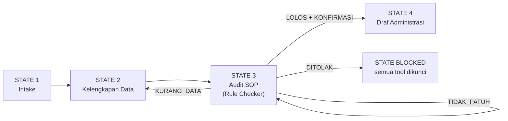
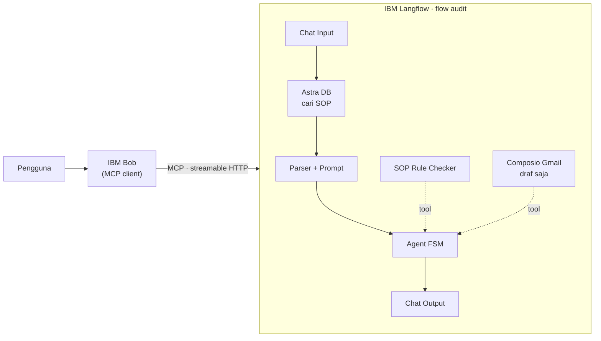

# ChiefOfStaff AI

**Agen audit SOP pengajuan pembelian untuk UMKM**, dibangun dengan IBM Langflow dan IBM Bob.

> Setiap pengajuan pembelian dicek terhadap SOP sebelum sampai ke pemberi persetujuan. Keputusan lolos/tolak diambil oleh kode yang dapat diuji, dan aksi akhir tetap di tangan manusia.

Proyek untuk kompetisi AI Agent **Hacktiv8 × IBM** · Universitas Katolik Widya Mandala Surabaya

---

## Masalah

Di UMKM dengan 10–50 karyawan, pengajuan pembelian biasanya dikirim lewat chat lalu dicek manual oleh satu orang admin atau langsung oleh pemilik.

- Data pengajuan hampir selalu kurang, sehingga vendor, sisa anggaran, dan jumlah penawaran harus ditanyakan ulang.
- Aturan berbasis angka, seperti batas nominal per approver dan minimal penawaran pembanding, mudah terlewat.
- Saat admin atau pemilik tidak ada, proses berhenti.
- Chatbot AI umum tidak mengetahui SOP internal dan bisa mengambil keputusan berdasarkan asumsi.

## Solusi

ChiefOfStaff AI memisahkan pekerjaan menjadi tiga lapis:

| Lapis | Komponen | Peran |
|---|---|---|
| 1. Retrieval SOP | Astra DB + Google embeddings | Mencari pasal SOP yang relevan. Bila aturan tidak ditemukan, agen menyatakannya, bukan mengarang. |
| 2. SOP Rule Checker | Custom component Python | Memutuskan status secara deterministik: `KURANG_DATA`, `TIDAK_PATUH`, `DITOLAK`, atau `LOLOS`, lengkap dengan nomor pasal. |
| 3. Draf + KONFIRMASI | Composio Gmail (draf saja) | Draf email hanya dibuat setelah status `LOLOS` dan pengguna mengetik `KONFIRMASI`. Pengiriman tetap dilakukan manusia. |

### Alur kerja agen (Finite State Machine)



### Arsitektur



Logika workflow berada di Langflow, sedangkan logika percakapan berada di IBM Bob. Keduanya dapat diuji secara terpisah.

---

## Isi repositori

| File | Fungsi |
|---|---|
| `ChiefOfStaff_AI_flow_optimized.json` | Flow Langflow: alur ingest SOP ke Astra DB dan alur audit (Chat Input → Astra DB → Parser → Prompt → Agent FSM → Chat Output). |
| `sop_rule_checker.py` | Custom component Langflow untuk audit deterministik: menghitung total, batas approver, minimal penawaran, sisa anggaran, vendor terlarang, dan tenggat. |
| `SOP_Pengadaan_Contoh.md` | Dokumen SOP pengadaan **fiktif** untuk demo. Angkanya sama dengan aturan di `sop_rule_checker.py`. |

---

## Cara menjalankan

### Prasyarat
- Langflow 1.11.x atau lebih baru yang berjalan lokal di `http://127.0.0.1:7860`
- Akun [Astra DB](https://astra.datastax.com) (paket gratis) dan Google AI API key
- (Opsional) Akun Composio untuk Gmail
- (Opsional) IBM Bob dan [`uv`](https://docs.astral.sh/uv/) untuk integrasi MCP

### 1. Import flow
1. Buka Langflow → **Projects** → **Upload/Import** → pilih `ChiefOfStaff_AI_flow_optimized.json`.
2. Buka **Settings → Global Variables**, lalu tambahkan `GOOGLE_API_KEY` dan `ASTRA_DB_APP_TOKEN` (tipe *Credential*).
3. Di **kedua** node Astra DB, pilih database Anda lalu buat collection baru:
   - Nama: `sop_pengadaan`
   - Embedding: *Bring your own*
   - Dimensi: `3072`

### 2. Ingest SOP
Di node **Read File**, upload `SOP_Pengadaan_Contoh.md` (atau salinannya dalam format `.txt`), lalu klik ▶ pada node **Astra DB · Simpan SOP**.

### 3. Pasang SOP Rule Checker
1. Tambahkan **Custom Component**, klik **Code**, lalu tempel seluruh isi `sop_rule_checker.py` → **Check & Save**.
2. Nyalakan **Tool Mode**, lalu sambungkan output **Toolset** ke port **Tools** pada Agent.

Kalau muncul error `No module named 'lfx'` (Langflow versi lama), ganti baris import dengan:
```python
from langflow.custom import Component
from langflow.io import MultilineInput, Output
from langflow.schema import Data
```

### 4. Uji di Playground
```
Sari, Gudang, beli 2 printer @2.500.000 di Toko A, butuh 15 Oktober 2026,
sisa anggaran 8 juta, sudah 2 penawaran, karena printer lama rusak
```
Hasil yang diharapkan: status **LOLOS**, total Rp5.000.000, approver Manajer Operasional, lalu agen meminta pengguna mengetik `KONFIRMASI`.

### 5. Hubungkan ke IBM Bob lewat MCP
1. Di Langflow, buka **Settings → Langflow API Keys** dan buat API key baru.
2. Buka **Projects → tab MCP Server**:
   - **Add Auth** → pilih **API key**.
   - **Edit Tools** → beri nama tool yang pendek, misalnya `audit_pengajuan`. Nama yang terlalu panjang bisa terpotong dan memicu error "flow not found".
3. Buat file `.bob/mcp.json` di folder project Bob:

```json
{
  "mcpServers": {
    "chiefofstaff": {
      "command": "/Users/<nama-user>/.local/bin/uvx",
      "args": [
        "--with", "mcp<2",
        "mcp-proxy",
        "--transport", "streamablehttp",
        "--headers", "x-api-key", "<LANGFLOW_API_KEY>",
        "http://127.0.0.1:7860/api/v1/mcp/project/<PROJECT_ID>/streamable"
      ]
    }
  }
}
```

Catatan: `--with "mcp<2"` diperlukan karena `mcp-proxy` versi terbaru tidak kompatibel dengan library `mcp` 2.x (`ImportError: request_ctx`).

---

## Contoh aturan SOP (fiktif)

| Total pengajuan | Approver | Minimal penawaran |
|---|---|---|
| ≤ Rp1.000.000 | Kepala Divisi | 1 |
| Rp1–10 juta | Manajer Operasional | 2 |
| Rp10–50 juta | Direktur/Pemilik | 3 |
| > Rp50 juta | Di luar alur, wajib rapat direksi | – |

Aturan tambahan: total tidak boleh melebihi sisa anggaran divisi, vendor dalam daftar terlarang ditolak, dan pengajuan dikirim paling lambat 3 hari sebelum tanggal dibutuhkan.

---

## Status pengujian (uji awal, 3 Oktober 2026)

| Indikator | Hasil |
|---|---|
| Status audit benar | 8/8 skenario yang diuji |
| Kutipan nomor pasal tepat | 6/8 (ditulis oleh LLM, masih diperbaiki) |
| Pembuatan draf Gmail end-to-end | Belum diuji |
| Bug ditemukan & diperbaiki | 1 (tahun pada tanggal tanpa tahun ditebak salah) |

Model yang dipakai saat pengujian: `gemini-3.5-flash-lite`. Angka di atas adalah hasil uji awal pada skala kecil, bukan klaim akurasi produksi.

## Responsible AI

- **Transparansi:** setiap balasan menampilkan label state dan membedakan sumber informasi (pasal SOP, Rule Checker, atau saran umum).
- **Kontrol manusia:** tidak ada aksi eksternal sebelum `KONFIRMASI`. Gmail hanya membuat draf, dan IBM Bob meminta izin sebelum memanggil tool.
- **Privasi:** hanya 10 field pengajuan yang dikumpulkan, dan kredensial disimpan di Global Variables, bukan di dalam flow.
- **Fairness:** aturan yang sama dijalankan oleh kode yang sama untuk semua pemohon.

## Batasan yang diketahui

- Agen tidak menilai kewajaran harga atau kualitas vendor.
- SOP yang ambigu akan menghasilkan jawaban "aturan tidak ditemukan".
- Kutipan pasal dari LLM masih bisa keliru, sehingga keputusan tidak bergantung pada kutipan tersebut.
- Riwayat percakapan lewat MCP belum menyambung antarpanggilan, jadi untuk demo kirim data lengkap dalam satu pesan.
- Integrasi Gmail (OAuth Composio) masih dalam proses.

## Tim

- Yohannes Marcel Lalopua
- Daniel ([@rhezadaniel7](https://github.com/rhezadaniel7))

Universitas Katolik Widya Mandala Surabaya
